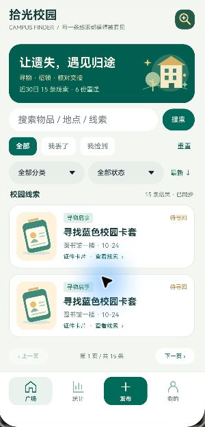
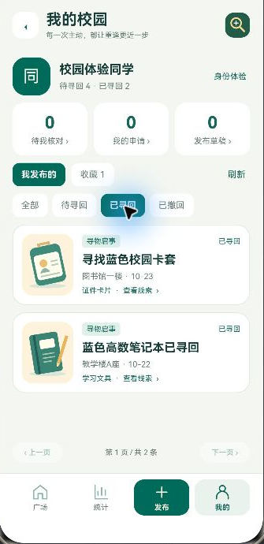

# 拾光校园 · Campus Finder

原生 HarmonyOS 校园失物招领与寻回数据可视化课程项目。第四版覆盖完整的本机演示业务：发布与编辑启事、组合搜索、收藏、认领或提供线索、双方核对交接、撤回恢复、个人记录和动态统计。





## 功能

- 管理升级：本人启事可按待寻回、已寻回、已撤回筛选；申请中心默认聚焦待核对，可查看全部、已通过、未通过、已取消。草稿支持二次确认舍弃，并校验身份与保存版本，旧页面不会误删新内容。
- 草稿续写：按体验身份保存未填完整的内容，返回时提醒保存，重新进入恢复；三步预览后提交，成功后原子清理对应草稿，失败可重试。
- 相似线索：从开放启事查找同类、相反类型、不同发布者的候选，按地点和日期排序并说明理由；仍需人工核对，联系信息保持原有保护。
- 个人任务：待我核对、我的申请、发布草稿和收藏数量均来自HTTP；广场、统计、我的复用矢量底部导航，主入口切换替换栈顶。
- 七个 Navigation 业务页面：失物广场、线索详情、三步发布/编辑、我的校园、互助统计、申请表单、认领与线索中心。
- 服务端组合筛选：类型、类别、关键词、状态、排序；分页按钮便于访问全部记录。
- 启事生命周期：待寻回 → 已寻回；待寻回 → 已撤回 → 恢复待寻回。仅所属演示身份能管理。
- 认领闭环：他人提交核对说明 → 发布者收到 → 核实交接并接受/拒绝；申请者可取消待处理申请。同一物品通过一份申请后自动关闭其余待处理申请。
- 收藏按演示身份持久化，申请双方才可查看申请联系指引；启事联系指引在认领通过后对申请者解锁。
- 三种 API 驱动图表：寻回率环图、类别柱状图、7/14/30日趋势折线；支持类别和日期范围组合筛选。
- 加载、失败、空数据、重试、表单校验、防重复提交、过期请求保护；JSON快照先落盘后替换内存，磁盘失败保持原状态。
- 原创本地SVG物品插画和校园主题插画，ArkUI V2统一组件与配色。

## 运行

环境：DevEco Studio 26.0，HarmonyOS API 26 SDK、Previewer；Node.js18+（本机 DevEco 自带24.14.1）。无第三方 ArkUI/Node 依赖。

```powershell
# 工程目录，保持服务运行
powershell -ExecutionPolicy Bypass -File .\scripts\start-mock.ps1
# 另一窗口编译
powershell -ExecutionPolicy Bypass -File .\scripts\build.ps1
# 真实HTTP回归：45项（40个子测试及5个父测试）
& 'E:\DevEco Studio\tools\node\node.exe' --test .\mock\server.test.cjs .\mock\workflow.test.cjs .\mock\experience.test.cjs .\mock\audit.test.cjs .\mock\management.test.cjs
# 直接加载实际 ArkTS 的接口校验与状态模型：15项
& 'E:\DevEco Studio\tools\node\node.exe' --test .\mock\native-model.test.cjs
```

模型测试使用本机 DevEco 自带 TypeScript 编译器，不复制生产实现；非默认安装位置设置 `DEVECO_PATH`，或通过 `TS_COMPILER_PATH` 指定编译器 JS 文件。应用及 HTTP Mock 运行本身无第三方依赖。

脚本支持 `-DevEcoPath`。Hvigor不支持中文工程路径；构建脚本生成临时英文目录并把未签名HAP拷回outputs。用IDE打开脚本输出的英文目录，选择 `entry/src/main/ets/pages/Index.ets`，点击Previewer眼睛图标。先启动Mock；连接失败点“重新加载”。Previewer无需真机、完整模拟器或签名。

Previewer连接 `http://127.0.0.1:4524`。其他设备需另行配置端口映射，未纳入本次验证。Mock仅监听本机；未签名HAP用于构建检查。

## 双角色演示

“我的→身份体验”提供校园、互助、志愿三个固定虚构身份，切换后请求头 `X-Demo-User` 随之更新。这是业务演示工具，**不是真实登录认证**。用校园同学申请 `seed-1` 校园卡，换互助同学在收到的申请中核对并确认，换回申请者查看结果与联系指引。新环境自动生成12条虚构记录；本机已执行操作，数量会不同。

数据保存 `mock/runtime/items.json`（不入Git）。第一版数组及旧对象自动兼容为包含items/claims/favorites/drafts的快照；不用删除旧数据。单进程串行写入，不承诺多进程数据库事务。

## 文档与评分

[第四版管理升级](docs/UPGRADE_V4.md) · [系统检查与纠错](docs/AUDIT.md) · [接口与状态机](docs/API.md) · [演示步骤](docs/DEMO.md) · [验证边界](docs/VALIDATION.md) · [要求核对](docs/ASSESSMENT.md)

| 项目 | 对应实现 |
| --- | --- |
| UI布局与容器 | Row、Column、List、Grid、Scroll；统一卡片/插画/状态样式 |
| 自定义组件与状态 | ComponentV2、Local、Param、Event、ObservedV2、Trace |
| Navigation | 七页路由、ID参数、子页返回与重新请求 |
| HTTP网络 | 持久化Mock、读取和写入、异常/空数据/重试 |
| Git和文档 | 真实阶段提交，接口与运行文档，学校模板报告仅本地交付 |
| 明确加分项 +10 | 真实网络动态数据可视化；三图及条件联动，不把图表数当多份加分 |

课程选题登记以提交者实际登记结果为准；源码不能证明登记状态，也不承诺教师分数。工程由Codex根据课程项目需求协助实现，保留真实阶段历史。提交者应理解代码并按课程要求披露辅助使用情况。

公开材料只含脱敏源码、虚构数据视口截图和处理后的历史；个人报告、提交ZIP、运行数据、日志、凭据均不上传。UI仅借鉴应用分类及信息组织思路，没有复用整套开源应用模板。项目限课堂演示，真实上线需认证、数据库并发、内容治理和校园服务对接。
