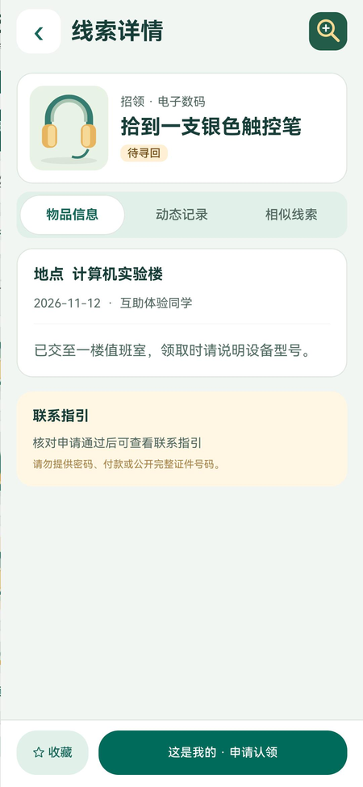

# 拾光校园 · Campus Finder

原生 HarmonyOS 校园失物招领与寻回数据可视化课程项目。支持发布与编辑启事、组合搜索、收藏、认领或提供线索、双方核对交接、撤回恢复、个人记录和动态统计。

| 失物广场 | 线索详情 | 寻回统计 |
| :---: | :---: | :---: |
|  |  |  |

截图来自 DevEco 原生预览，使用隔离的虚构演示数据。旧版截图可在 [screenshots](screenshots/) 查看。

[新版发布预览](screenshots/ui-refresh/publish.png) · [新版我的校园](screenshots/ui-refresh/my-campus.png)

[新版认领表单](screenshots/ui-refresh/claim-form.png) · [新版核对结果](screenshots/ui-refresh/claim-result.png)

[统计筛选入口](screenshots/ui-refresh/statistics-link.png) · [对应启事明细](screenshots/ui-refresh/statistics-items.png)

## 功能

- 管理升级：本人启事可按待寻回、已寻回、已撤回筛选；申请中心默认聚焦待核对，可查看全部、已通过、未通过、已取消。草稿支持二次确认舍弃，并校验身份与保存版本，旧页面不会误删新内容。
- 发布和草稿：分为基本信息、补充线索和预览确认。预览页可以直接返回修改指定部分，并区分公开内容和联系指引。在「我的校园」可按体验身份继续填写草稿，发布成功后服务会清理对应草稿。
- 相似线索：从开放启事查找同类、相反类型、不同发布者的候选，按地点和日期排序并说明理由；仍需人工核对，联系信息保持原有保护。
- 个人任务：待我核对、我的申请、发布草稿和收藏数量均来自HTTP；广场、统计、我的复用矢量底部导航，主入口切换替换栈顶。
- 八个 Navigation 业务页面包括失物广场、线索详情、三步发布/编辑、我的校园、互助统计、统计启事明细、申请表单和认领与线索中心。
- 广场支持类型、类别、多词搜索、状态和排序。点「筛选」可展开分类、状态和排序设置，收起后仍显示已选项数量。用空格分隔关键词，例如「校园卡 图书馆」。每页最多 6 条，翻页与重试沿用已提交的条件。
- 启事生命周期：待寻回 → 已寻回；待寻回 → 已撤回 → 恢复待寻回。仅所属演示身份能管理。
- 申请认领或提供线索时，表单会指出缺少的核对说明或联系指引。申请中心可分开查看收到与发出的申请，从处理提示直接查看结果。确认寻回会关闭同一物品的其他待核对申请，申请者也可以取消仍在等待的申请。
- 收藏按演示身份持久化，申请双方才可查看申请联系指引；启事联系指引在认领通过后对申请者解锁。
- 三种 API 驱动图表包含寻回率环图、类别柱状图和发布与寻回双折线。可选择 7、14 或 30 日及物品类别。没有近期记录时可以切换到「最近有记录」，拖动趋势图下的滑块即可查看指定发布日期的有效启事数与已寻回数。
- 点统计数字可查看当前日期范围与分类内的有效、已寻回或待寻回启事。趋势下的「查看当日启事」会带入所选发布日期。返回统计页时保留图表和滑块选中状态。
- 加载、失败、空数据、重试、表单校验、防重复提交、过期请求保护；JSON快照先落盘后替换内存，磁盘失败保持原状态。
- 原创本地SVG物品插画和校园主题插画，ArkUI V2统一组件与配色。

## 运行

环境：DevEco Studio 26.0，HarmonyOS API 26 SDK、Previewer；Node.js18+（本机 DevEco 自带24.14.1）。无第三方 ArkUI/Node 依赖。

```powershell
# 工程目录，保持服务运行
powershell -ExecutionPolicy Bypass -File .\scripts\start-mock.ps1
# 另一窗口编译
powershell -ExecutionPolicy Bypass -File .\scripts\build.ps1
# HTTP 回归：48 项（43 个子测试及 5 个父测试）
& 'E:\DevEco Studio\tools\node\node.exe' --test .\mock\server.test.cjs .\mock\workflow.test.cjs .\mock\experience.test.cjs .\mock\audit.test.cjs .\mock\management.test.cjs
# 直接加载 ArkTS 接口校验与状态模型：18 项（含 3 个父测试）
& 'E:\DevEco Studio\tools\node\node.exe' --test .\mock\native-model.test.cjs
```

模型测试使用本机 DevEco 自带 TypeScript 编译器，不复制生产实现；非默认安装位置设置 `DEVECO_PATH`，或通过 `TS_COMPILER_PATH` 指定编译器 JS 文件。应用及 HTTP Mock 运行本身无第三方依赖。

脚本支持 `-DevEcoPath`。Hvigor不支持中文工程路径；构建脚本生成临时英文目录并把未签名HAP拷回outputs。用IDE打开脚本输出的英文目录，选择 `entry/src/main/ets/pages/Index.ets`，点击Previewer眼睛图标。先启动Mock；连接失败点“重新加载”。Previewer无需真机、完整模拟器或签名。

Previewer连接 `http://127.0.0.1:4524`。其他设备需另行配置端口映射，未纳入本次验证。Mock仅监听本机；未签名HAP用于构建检查。

## 双角色演示

“我的→身份体验”提供校园、互助、志愿三个固定虚构身份，切换后请求头 `X-Demo-User` 随之更新。这是业务演示工具，**不是真实登录认证**。用校园同学申请 `seed-1` 校园卡，换互助同学在收到的申请中核对并确认，换回申请者查看结果与联系指引。新环境自动生成12条虚构记录；本机已执行操作，数量会不同。

数据保存 `mock/runtime/items.json`（不入Git）。第一版数组及旧对象自动兼容为包含items/claims/favorites/drafts的快照；不用删除旧数据。单进程串行写入，不承诺多进程数据库事务。

## 文档与评分

[第四版管理升级](docs/UPGRADE_V4.md) · [系统检查与纠错](docs/AUDIT.md) · [接口与状态机](docs/API.md) · [演示步骤](docs/DEMO.md) · [验证边界](docs/VALIDATION.md) · [要求核对](docs/ASSESSMENT.md)

| 项目 | 对应实现 |
| --- | --- |
| UI布局与容器 | Row、Column、List、Grid、Scroll；统一卡片/插画/状态样式 |
| 自定义组件与状态 | ComponentV2、Local、Param、Event、ObservedV2、Trace |
| Navigation | 八页路由、启事 ID 与统计范围参数、子页返回和重新请求 |
| HTTP网络 | 持久化Mock、读取和写入、异常/空数据/重试 |
| Git和文档 | 真实阶段提交，接口与运行文档，学校模板报告仅本地交付 |
| 明确加分项 +10 | 真实网络动态数据可视化；三图及条件联动，不把图表数当多份加分 |

课程选题登记以提交者实际登记结果为准；源码不能证明登记状态，也不承诺教师分数。工程由Codex根据课程项目需求协助实现，保留真实阶段历史。提交者应理解代码并按课程要求披露辅助使用情况。

公开材料只含脱敏源码、虚构数据视口截图和处理后的历史；个人报告、提交ZIP、运行数据、日志、凭据均不上传。UI仅借鉴应用分类及信息组织思路，没有复用整套开源应用模板。项目限课堂演示，真实上线需认证、数据库并发、内容治理和校园服务对接。
