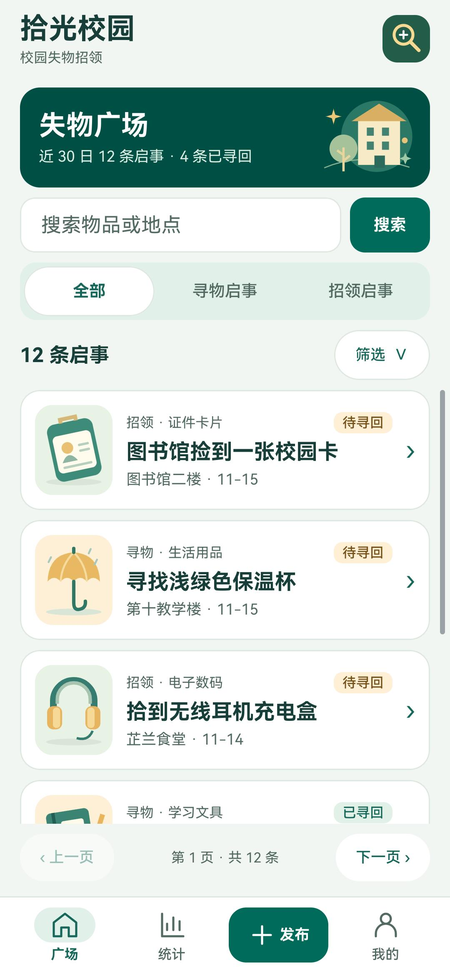
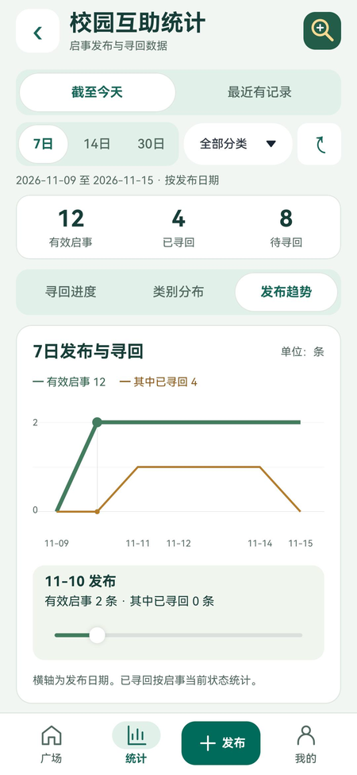

# 拾光校园 · Campus Finder

原生 HarmonyOS 校园失物招领与寻回数据可视化课程项目。支持发布与编辑启事、组合搜索、收藏、认领或提供线索、双方核对交接、撤回恢复、个人记录和动态统计。

| 失物广场 | 线索详情 | 寻回统计 |
| :---: | :---: | :---: |
|  |  |  |

截图来自 DevEco 原生预览，使用隔离的虚构演示数据。旧版截图可在 [screenshots](screenshots/) 查看。

[新版发布预览](screenshots/ui-refresh/publish.png) · [新版我的校园](screenshots/ui-refresh/my-campus.png)

[新版认领表单](screenshots/ui-refresh/claim-form.png) · [新版核对结果](screenshots/ui-refresh/claim-result.png)

[统计筛选入口](screenshots/ui-refresh/statistics-link.png) · [对应启事明细](screenshots/ui-refresh/statistics-items.png)

[拍照找物统计](screenshots/ui-refresh/ai-photo-funnel.png)

[相似线索对比](screenshots/ui-refresh/match-compare.png) · [发布者核对指引](screenshots/ui-refresh/claim-guidance.png)

## 功能

- 管理升级：本人启事可按待寻回、已寻回、已撤回筛选；申请中心默认聚焦待核对，可查看全部、已通过、未通过、已取消。草稿支持二次确认舍弃，并校验身份与保存版本，旧页面不会误删新内容。
- 发布和草稿：分为基本信息、补充线索和预览确认。预览页可以直接返回修改指定部分，并区分公开内容和联系指引。在「我的校园」可按体验身份继续填写草稿，发布成功后服务会清理对应草稿。
- 相似线索：从开放启事查找同类、相反类型、不同发布者的候选，按地点和日期排序。点「对比线索」可核对摘要、地点、发生日期和上下排列的完整描述，查看候选启事或继续申请。
- 招领媒体：可拍照、录短视频或选取相册照片。识别成功后自动填入四种既有类别之一，并预览标题和外观描述建议。发布者可将建议填入空白字段、手动修改并预览后发布。附件可在详情中查看。
- 拍照找物：从广场上传照片，利用识别结果、附件外观特征与启事文字排序，最多显示五条待认领候选。没有附件的旧启事也可通过标题、描述参与匹配。
- 描述找物：输入一句话后可让 AI 提取物品关键词、地点、类别和发生日期。确认或修改条件后再搜索开放招领启事，也可直接填写。结果栏显示已应用条件，翻页重试和从详情返回保留原查询。
- 拍照找物统计：从统计页进入，查看最近 7、14 或 30 日的识别、候选、申请和确认寻回。柱状图接收 HTTP 聚合数据，同一次查找在每阶段最多计一次。确认数来自发布者接受该次查找关联的实际申请。
- 个人任务：待我核对、我的申请、发布草稿和收藏数量均来自HTTP；广场、统计、我的复用矢量底部导航，主入口切换替换栈顶。
- 十二个 Navigation 业务页面包括失物广场、拍照找物、描述找物、拍照找物统计、线索详情、相似线索对比、三步发布/编辑、我的校园、互助统计、统计启事明细、申请表单和认领与线索中心。
- 广场支持类型、类别、多词搜索、状态和排序。点「筛选」可展开分类、状态和排序设置，收起后仍显示已选项数量。用空格分隔关键词，例如「校园卡 图书馆」。每页最多 6 条，翻页与重试沿用已提交的条件。
- 启事生命周期：待寻回 → 已寻回；待寻回 → 已撤回 → 恢复待寻回。仅所属演示身份能管理。
- 申请认领或提供线索时，表单会指出缺少的核对说明或联系指引。申请中心按身份和状态提示当前由谁核对及下一步操作。确认寻回会关闭同一物品的其他待核对申请，申请者也可以取消仍在等待的申请。
- 收藏按演示身份持久化，申请双方才可查看申请联系指引；启事联系指引在认领通过后对申请者解锁。
- 三种 API 驱动图表包含寻回率环图、类别柱状图和趋势图。趋势可切换「发布趋势」与「寻回趋势」，分别按发布日期和可靠确认寻回日期聚合；可选择 7、14 或 30 日及物品类别，两个窗口独立计算。没有近期记录时可切换到「最近有记录」，选择曲线中的单日查看对应明细。
- 可靠确认时间优先取确认寻回动态；没有动态时，仅接受有效且不同于 `createdAt` 的显式 `resolvedAt`。旧版把缺失时间补成发布时间的记录仍计入寻回总览，但不进入确认日期趋势或单日明细，页面会提示缺少可靠日期的数量。
- 点统计数字可查看当前发布日期范围与分类内的有效、已寻回或待寻回启事。点击类别柱可查看同一日期范围内该类别的有效启事。返回统计页时保留图表和单日选中状态。窄屏下筛选与图表页签分行显示，发布、申请、详情和相似线索操作区使用可换行内容与最小高度。
- 加载、失败、空数据、重试、表单校验、防重复提交、过期请求保护；JSON快照先落盘后替换内存，磁盘失败保持原状态。
- 原创本地SVG物品插画和校园主题插画，ArkUI V2统一组件与配色。

## 运行

环境：DevEco Studio 26.0，HarmonyOS API 26 SDK、Previewer；Node.js18+（本机 DevEco 自带24.14.1）。无第三方 ArkUI/Node 依赖。

```powershell
# 工程目录，保持服务运行
powershell -ExecutionPolicy Bypass -File .\scripts\start-mock.ps1
# 另一窗口编译
powershell -ExecutionPolicy Bypass -File .\scripts\build.ps1
# HTTP 及查找逻辑回归：63 项（含媒体、描述找物和统计归因）
& 'E:\DevEco Studio\tools\node\node.exe' --test .\mock\server.test.cjs .\mock\workflow.test.cjs .\mock\experience.test.cjs .\mock\audit.test.cjs .\mock\management.test.cjs .\mock\recovery.test.cjs .\mock\vision.test.cjs .\mock\search.test.cjs
# ArkTS 接口、状态模型、描述找物、招领建议和媒体取消边界：24 项（含 3 个父测试）
& 'E:\DevEco Studio\tools\node\node.exe' --test .\mock\native-model.test.cjs
```

模型测试使用本机 DevEco 自带 TypeScript 编译器，不复制生产实现；非默认安装位置设置 `DEVECO_PATH`，或通过 `TS_COMPILER_PATH` 指定编译器 JS 文件。应用及 HTTP Mock 运行本身无第三方依赖。

脚本支持 `-DevEcoPath`。Hvigor不支持中文工程路径；构建脚本生成临时英文目录并把未签名HAP拷回outputs。用IDE打开脚本输出的英文目录，选择 `entry/src/main/ets/pages/Index.ets`，点击Previewer眼睛图标。先启动Mock；连接失败点“重新加载”。Previewer无需真机、完整模拟器或签名。

Previewer连接 `http://127.0.0.1:4524`。本地模拟器可用 `hdc rport tcp:4524 tcp:4524` 让设备访问本机 Mock；实体真机需按实际连接方式另行配置。Mock仅监听本机；未签名HAP用于构建与模拟器检查。

### 开启 AI 分类和拍照找物

使用隐藏输入的启动脚本，可在本机配置模型与密钥，并执行状态、文本和照片联调。[AI 配置步骤](docs/AI_SETUP.md)

- 媒体上传需要服务端 FFmpeg（包含 H.264 编码器），可放入 PATH 或通过 `CAMPUS_FFMPEG` 指定可执行文件。每条招领启事可附一张照片或一段短视频，视频保留前 15 秒画面，去除音轨并转换为 MP4。
- 启动 Mock 前在服务端环境设置 `CAMPUS_VISION_API_KEY` 与 `CAMPUS_VISION_MODEL`。可选设置 `CAMPUS_VISION_BASE_URL`，默认 `https://api.openai.com/v1`。服务必须兼容 Chat Completions 的图片输入与 JSON 输出，密钥只由服务端使用。模型会接收处理后的照片或视频画面。 [图片输入参考](https://developers.openai.com/api/docs/guides/images-vision)
- 未配置模型时，招领附件仍可上传，分类由用户选择，广场仍可使用关键词搜索。发布附件保存在本机的 `mock/runtime/media`，查找用照片处理后丢弃。课堂演示请使用虚构样图。 [HarmonyOS 系统相机参考](https://developer.huawei.com/consumer/en/doc/harmonyos-references/js-apis-camerapicker/)
- 描述找物的 AI 提取沿用同一模型配置。未配置识别服务或解析失败时仍可手动搜索。全量测试共 87 项。本机识别服务替身及真实 FFmpeg 用于验证媒体和查找流程。真实模型识别、相机、中文输入法和视频播放需在相应设备与服务环境复验。

## 双角色演示

“我的→身份体验”提供校园、互助、志愿三个固定虚构身份，切换后请求头 `X-Demo-User` 随之更新。这是业务演示工具，**不是真实登录认证**。用校园同学申请 `seed-1` 校园卡，换互助同学在收到的申请中核对并确认，换回申请者查看结果与联系指引。新环境自动生成12条虚构记录；本机已执行操作，数量会不同。

数据保存 `mock/runtime/items.json`（不入Git）。第一版数组及旧对象自动兼容为包含items/claims/favorites/drafts的快照；不用删除旧数据。单进程串行写入，不承诺多进程数据库事务。

## 文档与评分

[第四版管理升级](docs/UPGRADE_V4.md) · [系统检查与纠错](docs/AUDIT.md) · [接口与状态机](docs/API.md) · [演示步骤](docs/DEMO.md) · [验证边界](docs/VALIDATION.md) · [要求核对](docs/ASSESSMENT.md)

| 项目 | 对应实现 |
| --- | --- |
| UI布局与容器 | Row、Column、List、Grid、Scroll；统一卡片/插画/状态样式 |
| 自定义组件与状态 | ComponentV2、Local、Param、Event、ObservedV2、Trace |
| Navigation | 十页路由、启事 ID 与统计范围参数、子页返回和重新请求 |
| HTTP网络 | 持久化Mock、读取和写入、异常/空数据/重试 |
| Git和文档 | 真实阶段提交，接口与运行文档，学校模板报告仅本地交付 |
| 明确加分项 +10 | 真实网络动态数据可视化；三图及条件联动，不把图表数当多份加分 |

课程选题登记以提交者实际登记结果为准；源码不能证明登记状态，也不承诺教师分数。工程由Codex根据课程项目需求协助实现，保留真实阶段历史。提交者应理解代码并按课程要求披露辅助使用情况。

公开材料只含脱敏源码、虚构数据视口截图和处理后的历史；个人报告、提交ZIP、运行数据、日志、凭据均不上传。UI仅借鉴应用分类及信息组织思路，没有复用整套开源应用模板。项目限课堂演示，真实上线需认证、数据库并发、内容治理和校园服务对接。
